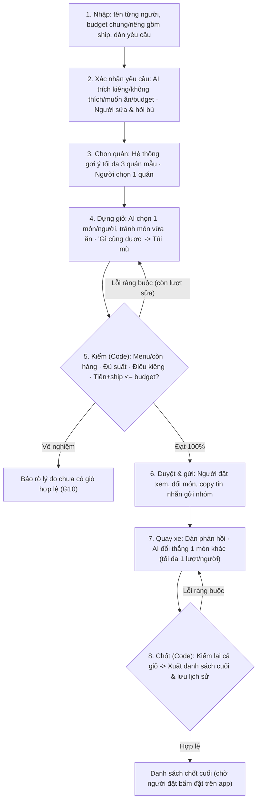

# PIPELINE CHỐT — Track D · D2: Đặt đơn cơm trưa nhóm có ràng buộc ăn uống

> **Nguồn sự thật duy nhất của luồng sản phẩm (Nhóm Opus · L3B).** Khớp `canvas.md`, `spec.md §4` và `codebase/`.

## 1. Luồng 8 bước đã chốt

| Bước | Tên bước | Ai làm gì | Đầu ra / Cổng chuyển bước |
|---|---|---|---|
| **1** | **Nhập** | **Người đặt** nhập tên từng người, budget chung hoặc riêng (đã gồm phí ship chia đều), gõ tự do hoặc dán tin nhắn yêu cầu của nhóm. | Bản thô yêu cầu nhóm + ngân sách |
| **2** | **Xác nhận yêu cầu** | **AI** trích xuất có cấu trúc: `kiêng · không thích · muốn ăn · budget` theo từng người. **Người đặt** sửa lại, hỏi bù chỗ chưa rõ (thiếu ngân sách, thiếu tên/số người, yêu cầu mập mờ) rồi bấm xác nhận. | Bảng yêu cầu đã khóa ràng buộc |
| **3** | **Chọn quán** | **Hệ thống** lọc và đề xuất **tối đa 3 quán** phù hợp từ danh sách quán mẫu (`data/restaurants_sample.json`). **Người đặt** chọn **1 quán**. | `restaurant_id` đã chọn + phí ship |
| **4** | **Dựng giỏ** | **AI** chọn mỗi người một món trong menu quán đã chọn, tránh các món vừa ăn gần đây (nếu có lịch sử). Người ghi *"gì cũng được"* nhận **túi mù** (món hợp ngân sách + không đụng điều kiêng). | Giỏ đề xuất nháp (1 món/người) |
| **5** | **Kiểm** | **Code** kiểm tra tất định 4 điều kiện: (1) món có trong menu & còn hàng (`in_stock`), (2) đủ suất theo số người, (3) không vi phạm điều kiêng/dị ứng/chay, (4) `giá món + phí ship / số người ≤ budget` từng người. Nếu sai → báo lỗi cụ thể để AI đổi món (tối đa `MAX_STEPS = 5`) hoặc báo vô nghiệm kèm lý do. | Giỏ đạt kiểm tra code (`PASS`) hoặc lý do vô nghiệm |
| **6** | **Duyệt và gửi** | **Người đặt** xem giỏ đã kiểm, tự đổi món nếu cần, copy tin nhắn tóm tắt giỏ để gửi cho nhóm. | Tin nhắn nháp chờ nhóm phản hồi |
| **7** | **Quay xe** | Ai trong nhóm không ưng thì phản hồi, người đặt dán phản hồi vào hệ thống. **AI** đổi thẳng một món khác phù hợp trong cùng quán — **giới hạn mỗi người tối đa 1 lượt quay xe**. | Giỏ sau quay xe |
| **8** | **Chốt** | **Code** kiểm lại toàn bộ giỏ sau quay xe (menu, tồn hàng, đủ suất, kiêng, ngân sách gồm ship), xuất danh sách đặt cuối cùng và **lưu lịch sử** vào SQLite cục bộ (`data/lunchie.sqlite3`) để phiên sau tra hồ sơ và món vừa ăn. | Danh sách chốt cuối + bản ghi lịch sử |

## 2. Sơ đồ luồng & Chốt kiểm

## 3. Phân định ranh giới AI · Code · Người dùng

- **AI làm:** Hiểu tiếng Việt tự nhiên để trích cấu trúc yêu cầu (bước 2); gợi ý chọn món, gán **túi mù** cho người *"gì cũng được"*, né món vừa ăn (bước 4); chọn món thay thế khi người dùng quay xe (bước 7). **Không tự bịa món/giá, không tự bỏ qua điều kiêng.**
- **Code kiểm (`codebase/tools.py`, `codebase/storage.py`):** Lọc ứng viên quán (bước 3); kiểm tra cứng tồn tại món, `in_stock`, đủ suất, không đụng thành phần dị ứng/chế độ ăn, tính tiền + phí ship chia đều ≤ budget (bước 5 & bước 8); lưu hồ sơ khi người dùng tự chọn và chốt giỏ/lịch sử idempotent trong SQLite cục bộ (bước 8).
- **Người đặt quyết (Human-in-the-loop):** Nhập yêu cầu & ngân sách nhóm (bước 1), xác nhận thông tin trích xuất (bước 2), chọn 1 quán (bước 3), duyệt và copy gửi nhóm (bước 6), dán phản hồi quay xe từ nhóm (bước 7), tự bấm đặt đơn và thanh toán trên app ngoài sau bước 8.

## 4. Bất biến hệ thống (Không được phá vỡ)
1. **Không bịa dữ liệu:** Chỉ chọn món có `dish_id` và `price_vnd` khớp 100% trong `data/restaurants_sample.json`.
2. **An toàn dị ứng/chay là tối thượng:** Code chặn tuyệt đối mọi giỏ có món vi phạm `kiêng/dị ứng/chay`; không đổi điều kiện kiêng kể cả khi bị prompt tấn công.
3. **Minh bạch khi thiếu tin hoặc vô nghiệm (G10):** Thiếu ngân sách/ràng buộc → hỏi bù ở bước 2; không quán/món nào thỏa ngân sách gồm ship → báo rõ lý do vô nghiệm, không bịa giảm giá.
4. **Không tác động ra ngoài:** Hệ thống chỉ xuất bản nháp tin nhắn và danh sách chốt cuối; không gọi API đặt đơn hay thanh toán thật.
